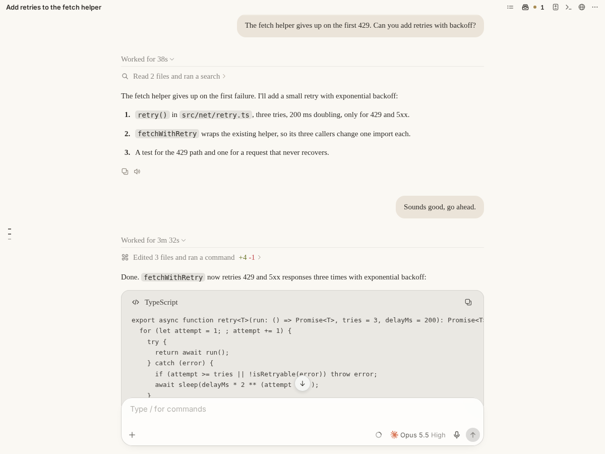

# Paper



A warm, roomy reading look for agent chats in cmux: serif replies on off-white paper, ink-brown text,
a sepia accent, and soft rounded prompts.

Paper is a light look. Its theme file picks a light base theme and `agent-pane/theme.css` is written
for a light chat, so use the stylesheet on its own only over a light theme.

It is built only from public surfaces, so you can copy any part of it:

| File | What it does |
| --- | --- |
| `cmux-setup.json` | Picks the theme file; sets the chat's serif font, size, line height and width and the sidebar's density |
| `themes/paper.json` | The colors, surfaces and density |
| `agent-pane/theme.css` | The prompt bubble and cards, with `cmux.agentPane.style/1` tokens only |
| `customize/` | A reading hover card with the task in full, and calm sidebar rows |

```sh
cmux setup install github.com/manaflow-ai/cmux-paper-look
cmux setup remove manaflow-ai/paper-look
```

While it is installed, its `customize/` view stands in for your own sidebar view, if you have one;
`cmux setup remove` puts yours back.

How looks like this one are written: [look-addons.md](https://github.com/manaflow-ai/cmux/blob/639a429492936ae3b4f0d4a1e6d7fbf66e708520/docs/cmux-next/look-addons.md).
